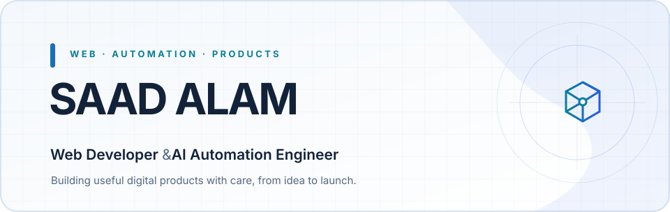
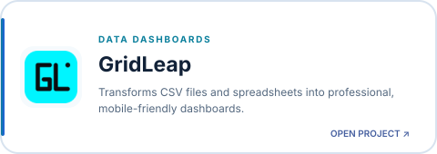
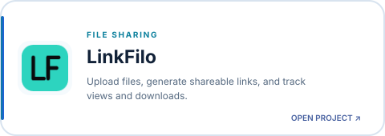
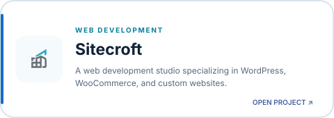
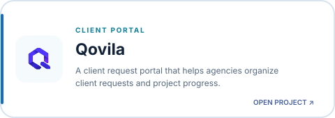

<!-- Generated by scripts/build_profile.py; edit the source in scripts/ instead. -->

  <picture>
    <source media="(prefers-color-scheme: dark)" srcset="assets/banner-dark.svg">
    <source media="(prefers-color-scheme: light)" srcset="assets/banner-light.svg">
    
  </picture>

  <a href="https://github.com/alamzweb">GitHub</a> &nbsp;·&nbsp;
  <a href="https://x.com/msaad_alam">X</a> &nbsp;·&nbsp;
  <a href="mailto:contact@dnnengineer.com">Email</a>

## About

I build practical web products, websites, and automation workflows — from the first idea through launch.

## Selected work

<table width="100%">
<tr>
<td width="50%" valign="top">
<a href="https://gridleap.vercel.app/">
  <picture>
    <source media="(prefers-color-scheme: dark)" srcset="assets/gridleap-card-dark.svg">
    <source media="(prefers-color-scheme: light)" srcset="assets/gridleap-card-light.svg">
    
  </picture>
</a>
</td>
<td width="50%" valign="top">
<a href="https://linkfilo.vercel.app/">
  <picture>
    <source media="(prefers-color-scheme: dark)" srcset="assets/linkfilo-card-dark.svg">
    <source media="(prefers-color-scheme: light)" srcset="assets/linkfilo-card-light.svg">
    
  </picture>
</a>
</td>
</tr>
<tr>
<td width="50%" valign="top">
<a href="https://sitecroftdev.vercel.app/">
  <picture>
    <source media="(prefers-color-scheme: dark)" srcset="assets/sitecroft-card-dark.svg">
    <source media="(prefers-color-scheme: light)" srcset="assets/sitecroft-card-light.svg">
    
  </picture>
</a>
</td>
<td width="50%" valign="top">
<a href="https://qovila.vercel.app/">
  <picture>
    <source media="(prefers-color-scheme: dark)" srcset="assets/qovila-card-dark.svg">
    <source media="(prefers-color-scheme: light)" srcset="assets/qovila-card-light.svg">
    
  </picture>
</a>
</td>
</tr>
</table>

## Technology

<!-- Generated technology icon grid; edit the catalog in scripts/theme.py. -->
<!-- TECHNOLOGY_STACK_START -->
### Languages & frontend

<table align="center">
  <tr><td align="center" width="120"> HTML5</td><td align="center" width="120"> CSS3</td><td align="center" width="120"> JavaScript</td><td align="center" width="120"> TypeScript</td></tr>
  <tr><td align="center" width="120"> React</td><td align="center" width="120"><picture><source media="(prefers-color-scheme: dark)" srcset="https://cdn.simpleicons.org/nextdotjs/FFFFFF"></picture> Next.js</td><td align="center" width="120"> Tailwind CSS</td><td align="center" width="120"> Python</td></tr>
</table>

### CMS & data

<table align="center">
  <tr><td align="center" width="120"> WordPress</td><td align="center" width="120"> WooCommerce</td><td align="center" width="120"> Supabase</td><td align="center" width="120"> PostgreSQL</td></tr>
</table>

### Automation & developer tools

<table align="center">
  <tr><td align="center" width="120"> n8n</td><td align="center" width="120"> Git</td><td align="center" width="120"><picture><source media="(prefers-color-scheme: dark)" srcset="https://cdn.simpleicons.org/github/FFFFFF"></picture> GitHub</td><td align="center" width="120"><picture><source media="(prefers-color-scheme: dark)" srcset="https://cdn.simpleicons.org/vercel/FFFFFF"></picture> Vercel</td></tr>
  <tr><td align="center" width="120"> VS Code</td></tr>
</table>
<!-- TECHNOLOGY_STACK_END -->

---

  <a href="https://x.com/msaad_alam">Connect on X</a> &nbsp;·&nbsp;
  <a href="mailto:contact@dnnengineer.com">Contact by email</a>

  

